# 시스템 테스트 이슈 — 2026-11-24

> Playwright(Chromium, 모바일 폭 400×860)로 실제 화면을 조작해 찾은 결함 목록이다.
> 시드 데이터 기준 · 계정 `warehouse@demo.kr` · `npm run dev` 환경.

## 요약

| # | 심각도 | 화면 | 내용 |
|---|---|---|---|
| [ISSUE-01](#issue-01) | 🔴 높음 | 출고 · 팝업 반출 · 일일 반영 | FEFO가 **이미 만료된 로트**를 1순위로 내보낸다 |
| [ISSUE-02](#issue-02) | 🔴 높음 | 풀필먼트 발송 | 만료 로트가 풀필먼트로 발송되고, 경고는 "임박분"으로만 뜬다 |
| [ISSUE-03](#issue-03) | 🟠 중간 | 홈 · 상품 상세 | "지금 출고 가능" · "가용" 숫자에 만료 재고가 포함된다 |
| [ISSUE-04](#issue-04) | 🟠 중간 | 모든 수량 입력칸 | `1.5` 입력 시 소수점만 지워져 **15개**가 된다 |
| [ISSUE-05](#issue-05) | 🟠 중간 | 출고 (수동 로트 선택) | 빼는 곳을 바꿔도 이전 거점 로트 수량이 남아 저장이 실패한다 |
| [ISSUE-06](#issue-06) | 🟠 중간 | 풀필먼트 발송 | 같은 상품을 두 번 담을 수 있고, 확정하면 엉뚱한 재고 부족 오류가 난다 |
| [ISSUE-07](#issue-07) | 🟠 중간 | 팝업 만들기 · 홈 필터 | 팝업 이름 중복 허용 → 홈 필터가 두 팝업을 섞고 React key 오류가 난다 |
| [ISSUE-08](#issue-08) | 🟡 낮음 | 배송 중 목록 · 발송 상세 | 상품 1종이 로트 수만큼 "3종"으로 표시된다 |
| [ISSUE-09](#issue-09) | 🟡 낮음 | 상세 화면 4종 | ID가 숫자가 아니면 404가 아니라 500 서버 오류 |
| [ISSUE-10](#issue-10) | 🟡 낮음 | 개발 스크립트 | `npm run seed:reset`이 Windows에서 실패한다 |
| [ISSUE-11](#issue-11) | ⚪ 사소 | 팝업 정산 확인 | "자사창고**으로**" 조사 오류 |

---

<a id="issue-01"></a>
## ISSUE-01 · FEFO가 만료된 로트를 1순위로 내보낸다 🔴

**재현**
1. ＋ → 출고 → `치킨 스틱 10p` 선택, 빼는 곳 `자사창고`, 사유 `판매`
2. 출고 수량 `10` 입력

**기대** 만료 로트(2026-11-21, 3일 지남)는 판매 출고에서 제외되거나 최소한 막는 경고가 떠야 한다.
요구사항: "임박 재고를 먼저 출고하고 **만료 재고를 폐기한다**" (`docs/03-scenarios.md:41`)

**실제** 만료 로트 10개가 자동 선택되고 `10개 출고` 버튼이 그대로 활성화된다.
같은 문제가 **팝업 반출**(12/10~12/12 행사에 만료분 14개 배분)과 **풀필먼트 일일 반영**에도 있다.

| 출고 | 팝업 반출 |
|---|---|
| 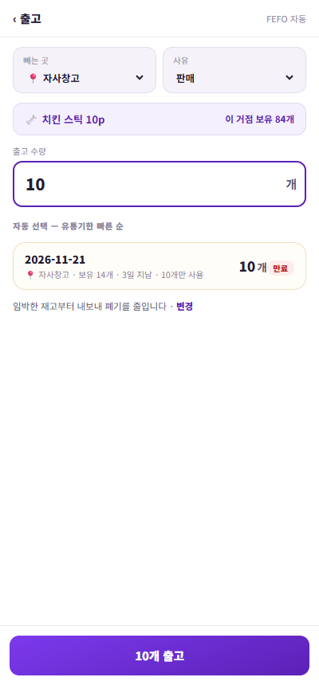 | 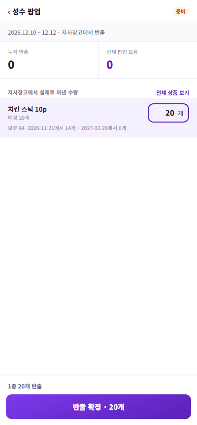 |

**원인** `src/lib/fefo.ts` `allocateLots()` 의 로트 조회 조건이 `quantity > 0` 뿐이고 유통기한을 보지 않는다. `planAllocation()`(클라이언트 미리보기)도 같다.

**제안** 판매·반출용 배분에서는 `expiryDate >= today()` 로트만 쓰고, 만료 로트는 폐기(M7 `/expiry`) 경로로만 빠지게 한다. 사유가 파손·폐기일 때만 만료분을 허용하는 식으로 전략에 옵션을 둔다.

---

<a id="issue-02"></a>
## ISSUE-02 · 풀필먼트 발송에 만료 로트가 섞이고 "임박분"으로만 표시된다 🔴

**재현** ＋ → 풀필먼트 발송 → ＋ 상품 담기 → `치킨 스틱 10p` → 보낼 수량 `80`

**실제** LEFO로 2027-02-28 70개를 쓴 뒤 모자란 10개를 **만료 로트(2026-11-21)**에서 채운다. 경고는 `⚠ 임박분이 포함됐습니다`로, 만료라는 사실이 드러나지 않는다. 확정 버튼도 활성화된다.

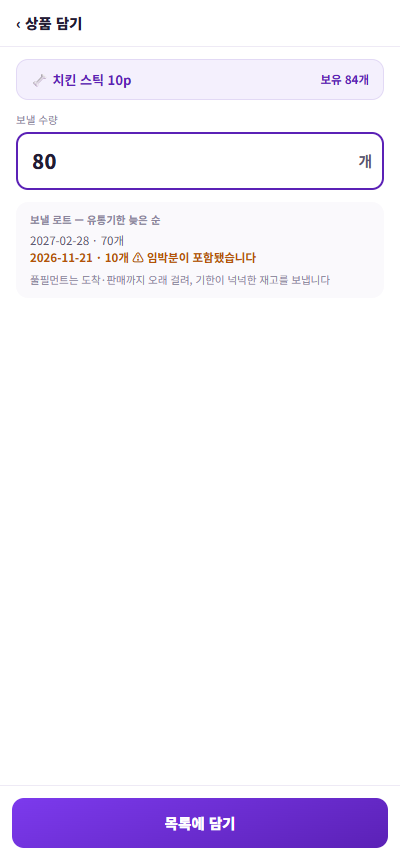

**원인** ISSUE-01과 같은 배분 함수. 경고 문구는 `src/components/TransferForm.tsx:102-106` 이 `days <= alertDays` 하나로 판단해서 만료(음수 일수)도 "임박"으로 뭉뚱그린다.

**제안** 만료 로트는 발송 배분에서 제외하고, 부족하면 "발송 가능 재고 70개"로 안내한다.

---

<a id="issue-03"></a>
## ISSUE-03 · "지금 출고 가능" · "가용"에 만료 재고가 포함된다 🟠

**재현** 홈에서 `치킨 스틱 10p` 확인 → 상품 상세 진입

**실제** 홈 목록 `90개 가용`, 상세 `지금 출고 가능 90개`. 이 중 20개(자사창고 14 · 풀필먼트 B 6)는 이미 만료된 로트다. 화면 상단 `가용 944개`에도 포함된다.

| 홈 | 상품 상세 |
|---|---|
| 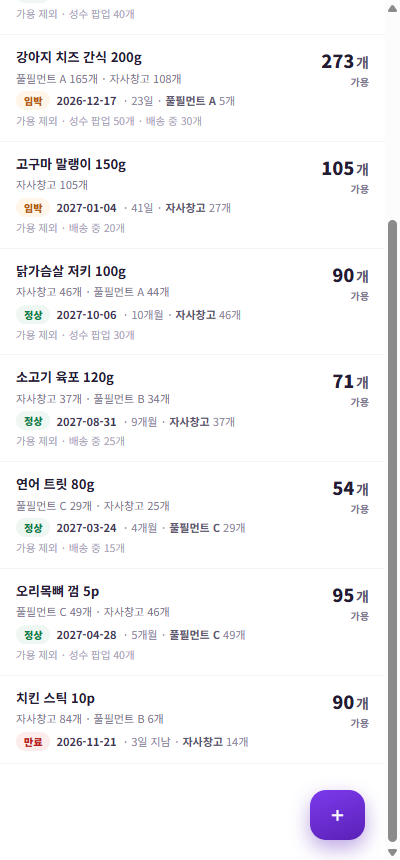 | 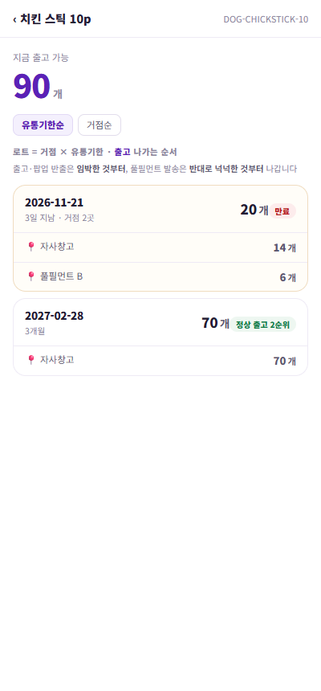 |

**원인** `src/lib/inventory.ts` 의 `available` 계산(33행 · 170행)이 거점 유형(배송 중·팝업)만 빼고 유통기한은 보지 않는다.

**제안** 만료분은 "가용 제외 · 만료 N개"로 따로 보여 준다. 상세 화면에서도 만료 카드를 출고 순번에서 빼고 "폐기 대상"으로 표기한다(지금은 만료 카드에 순번이 없고 다음 로트가 "출고 2순위"로 표시돼 만료분이 사실상 1순위임을 보여 준다).

---

<a id="issue-04"></a>
## ISSUE-04 · 수량칸에 `1.5`를 넣으면 15개가 된다 🟠

**재현** 출고 → 상품 선택 → 출고 수량에 `1.5` 붙여넣기(또는 입력)

**실제** 값이 `15`로 바뀌고 `15개 출고` 버튼이 활성화된다. `-5`는 `5`로 바뀐다. 알림 없이 10배 수량이 저장될 수 있다.

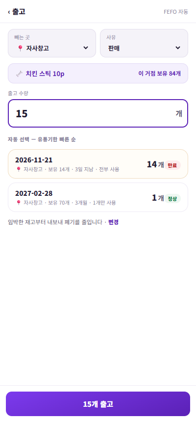

**원인** `src/components/QtyInput.tsx` `onChange={(e) => onChange(e.target.value.replace(/\D/g, ''))}` — 숫자가 아닌 문자를 **지우기만** 해서 `1.5` → `15`가 된다. 이 컴포넌트를 쓰는 입고·출고·발송·일일 반영·반출·정산 화면 전부 해당.

**제안** 숫자 외 문자가 섞이면 변경을 무시(이전 값 유지)하거나 소수점 이하를 버린다(`1.5` → `1`). `inputMode="numeric"` 와 함께 쓴다.

---

<a id="issue-05"></a>
## ISSUE-05 · 수동 로트 선택 후 빼는 곳을 바꾸면 이전 수량이 남는다 🟠

**재현**
1. 출고 → `치킨 스틱 10p` → 수량 `10` → `변경`(수동 선택)
2. 자사창고 `2027-02-28` 로트에 `2` 입력, 사유 입력
3. 빼는 곳을 `풀필먼트 B`로 변경 → 출고

**실제** 화면에는 풀필먼트 B의 로트(보유 6개)만 보이는데 `합계 2개`가 그대로 남는다. 이전 오류 문구도 지워지지 않는다. 저장하면 `재고가 부족합니다 (보유 0개, 요청 2개)` — 눈에 보이는 로트와 맞지 않아 원인을 알 수 없다.

| 거점 변경 직후 | 저장 시도 |
|---|---|
| 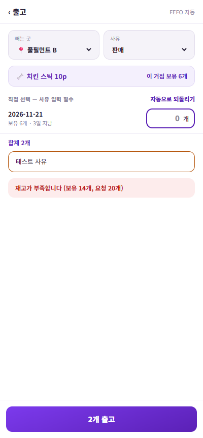 | 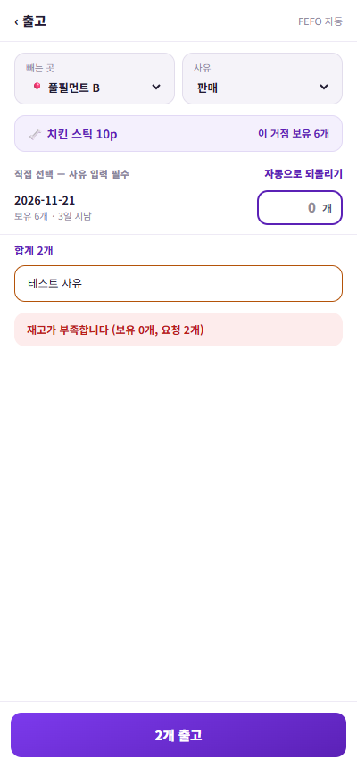 |

**원인** `src/components/OutboundForm.tsx` 빼는 곳 `onChange: setLocationId` 가 `manualQty` · `error` 를 초기화하지 않는다(로트 id 키가 그대로 남아 서버로 전송됨). 서버 `src/actions/outbound.ts` 도 수동 로트가 해당 상품·거점 소속인지 확인하지 않는다.

**제안** 거점·상품이 바뀌면 `setManualQty({})` · `setError(null)`. 서버에서 `lot.productId / lot.locationId` 일치를 검증한다.

---

<a id="issue-06"></a>
## ISSUE-06 · 발송 목록에 같은 상품을 두 번 담을 수 있다 🟠

**재현** 풀필먼트 발송 → `치킨 스틱 10p` 80개 담기 → 다시 ＋ 상품 담기 → `치킨 스틱 10p` 10개 담기 → 발송 확정

**실제**
- 두 번째 담기 화면이 이미 담은 80개를 빼지 않고 `보유 84개`로 보여 주고, 미리보기도 2027-02-28 10개로 계산한다(첫 줄과 같은 로트를 중복 배정).
- 목록이 `2종 90개`로 표시된다(실제 1종).
- 확정하면 `재고가 부족합니다 (보유 4개, 요청 10개)` — 사용자는 84개 중 90개를 담았다는 걸 알기 어렵다.

| 중복 담기 | 확정 결과 |
|---|---|
| 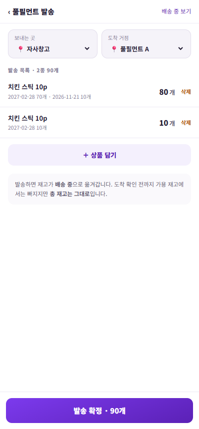 | 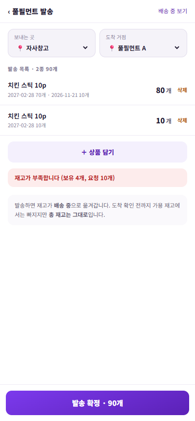 |

**원인** `src/components/TransferForm.tsx` 가 같은 `productId` 의 기존 줄을 합치지 않고 새 줄을 추가한다.

**제안** 같은 상품을 다시 고르면 기존 줄 수량을 수정하게 하거나, 상품 목록에서 이미 담은 상품은 "담김 80개"로 표시한다. 보유 표시는 이미 담은 수량을 빼서 보여 준다.

---

<a id="issue-07"></a>
## ISSUE-07 · 팝업 이름 중복 → 홈 필터가 두 팝업을 섞고 콘솔 오류 🟠

**재현** 이미 `성수 팝업`(진행 중)이 있는 상태에서 팝업 만들기 → 이름 `성수 팝업` → 생성 → 반출 확정 → 홈

**실제**
- 이름이 같은 팝업이 그대로 만들어진다.
- 홈 거점 칩에 `📍성수 팝업`이 두 개 생기고, 둘 다 같은 링크 `/?filter=성수 팝업`이다.
- 필터 결과에 두 팝업의 재고가 섞여 나온다(치킨 스틱 20개는 새 팝업, 나머지는 기존 팝업).
- 콘솔: `Encountered two children with the same key … 성수 팝업` (개발 오버레이 `1 Issue` 표시)

| 팝업 목록 | 홈 칩 (좌하단 오류 배지) | 필터 결과 |
|---|---|---|
|  | 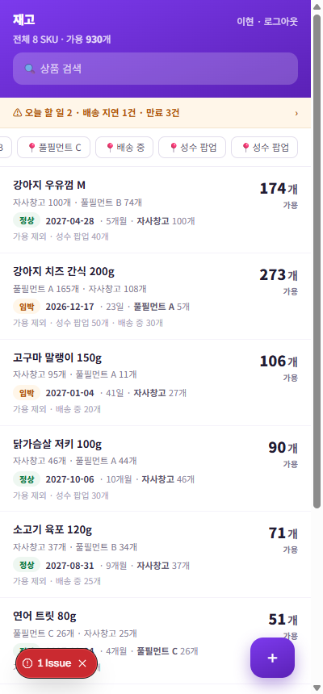 | 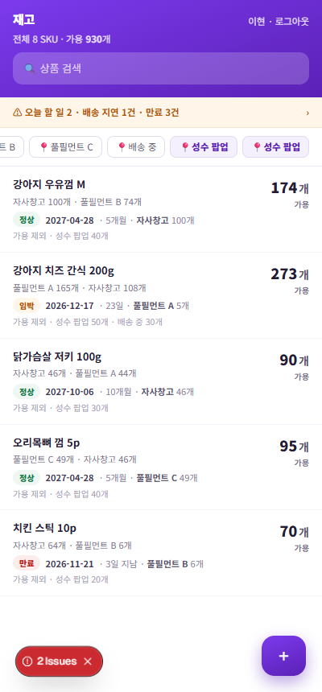 |

**원인** `src/actions/popup.ts` `createPopup()` 이 이름 중복을 막지 않는다. 홈 필터는 거점을 **이름**으로 거른다(`src/lib/inventory.ts:80` `l.name === filter`). 칩의 React key도 이름이다.

**제안** 필터 값과 key를 거점 `id`로 바꾼다. 진행 중·준비 상태 팝업끼리는 이름 중복을 막거나 기간을 붙여 구분한다(`성수 팝업 12/10`).

---

<a id="issue-08"></a>
## ISSUE-08 · 배송 중 목록에서 상품 1종이 "3종"으로 보인다 🟡

**재현** 풀필먼트 발송으로 `고구마 말랭이 150g` 10개 발송 → 배송 중 목록

**실제** LEFO로 로트 3개에서 나눠 나갔는데 `3종 10개`, 상품명도 `고구마 말랭이 150g 3개 · 고구마 말랭이 150g 5개 · 고구마 말랭이 150g 2개`로 반복된다. 발송 상세 헤더도 `3종 10개`.

| 배송 중 목록 | 발송 상세 |
|---|---|
| 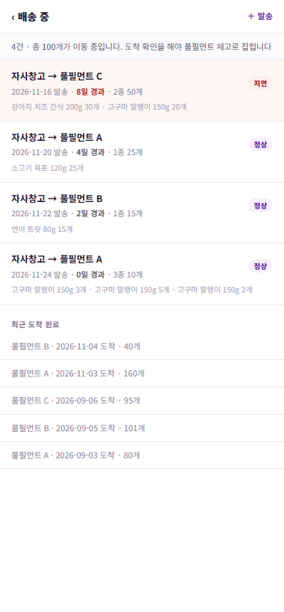 | 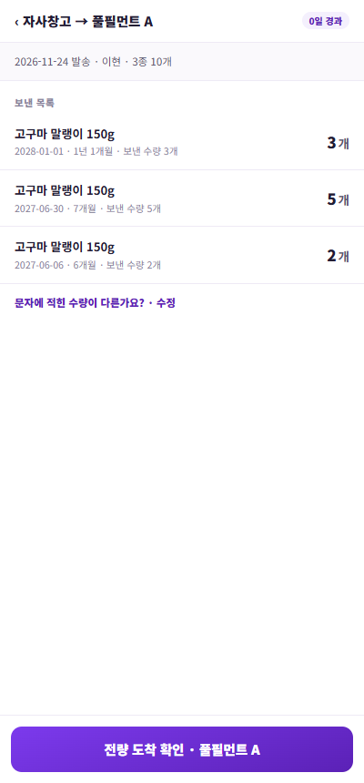 |

**원인** `src/app/transfers/page.tsx:68`, `src/app/transfers/[id]/page.tsx:47` 이 `t.lines.length`(로트 줄 수)를 "종"으로 표시한다.

**제안** `new Set(lines.map(l => l.productId)).size` 로 종 수를 세고, 요약 문구는 상품별로 합산해 보여 준다(`고구마 말랭이 150g 10개`).

---

<a id="issue-09"></a>
## ISSUE-09 · 숫자가 아닌 ID로 들어가면 500 서버 오류 🟡

**재현** `/products/abc`, `/transfers/abc`, `/popups/abc`, `/fulfillment/abc`

**실제** 500 "This page couldn't load". 숫자 ID가 없는 경우(`/products/999`)는 정상적으로 404다.

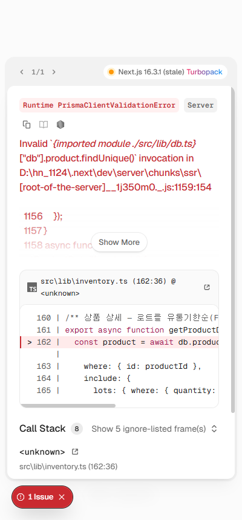

**원인** 각 페이지가 `Number(id)` 결과(`NaN`)를 그대로 Prisma `findUnique` 에 넘겨 예외가 난다.
`src/app/products/[id]/page.tsx:20` · `src/app/transfers/[id]/page.tsx:15` · `src/app/popups/[id]/page.tsx:15` · `src/app/popups/[id]/settle/page.tsx:10` · `src/app/fulfillment/[locationId]/page.tsx:14`

**제안** `const n = Number(id); if (!Number.isInteger(n)) notFound()` 를 공통 헬퍼로 둔다.

---

<a id="issue-10"></a>
## ISSUE-10 · `npm run seed:reset`이 Windows에서 실패한다 🟡

**재현** Windows(PowerShell/cmd)에서 `npm run seed:reset`

**실제**
```
> rm -f prisma/dev.db prisma/dev.db-journal prisma/dev.db-wal prisma/dev.db-shm && npm run db:ensure
'rm' is not recognized as an internal or external command,
operable program or batch file.
```
README가 "시연 중 초기화 5초"로 안내하는 명령이 Windows 시연 PC에서 동작하지 않는다.

**원인** `package.json` 스크립트가 Unix `rm` 을 쓴다(npm은 Windows에서 cmd.exe로 실행).

**제안** `scripts/reset-db.ts` 에서 `fs.rmSync(..., { force: true })` 로 지운 뒤 `ensure-db` 를 호출하도록 바꾼다(추가 의존성 불필요). 참고: 개발 서버가 DB 파일을 열고 있으면 Windows에서는 삭제가 막히므로 서버를 멈춘 뒤 실행해야 한다는 안내도 README에 필요하다.

---

<a id="issue-11"></a>
## ISSUE-11 · 정산 확인 문구 조사 오류 ⚪

**재현** 팝업 → 정산 시작 → 수량 입력 → 다음 — 계산 확인

**실제** `잔여 7개는 유통기한 그대로 자사창고으로 돌아옵니다` → `자사창고로` 가 맞다.

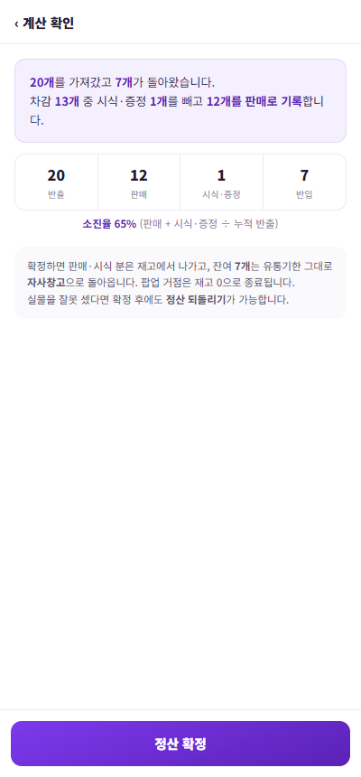

**원인** `src/components/SettleForm.tsx:117` `<b>{sourceName}</b>으로` 고정. 거점 이름 끝 글자의 받침 유무(ㄹ 받침 포함)에 따라 `로/으로` 를 고르는 헬퍼가 필요하다.

---

## 통과한 항목

| 영역 | 확인한 것 |
|---|---|
| 화면 순회 | 홈 · 필터 9종 · 상품 상세 8종(유통기한순/거점순) · 풀필먼트 3곳 · 배송 중 · 팝업 — 링크 따라 29개 + 메뉴 화면 6개, 모두 200 · 콘솔 오류 없음 |
| 인증 | 비로그인 접근 → `/login` 리다이렉트, 틀린 비밀번호 메시지, 로그인 상태에서 `/login` → 홈, 로그아웃 |
| 입고 | 잘못된 월(`271340`) 오류, 지난 날짜 경고, 사유 `기타` 시 메모칸 표시, 유통기한 2개 한 번에 저장 → 상세 반영(97 → 105) |
| 출고 | 보유 초과 시 버튼 비활성, 수동 선택에서 로트 보유 초과 시 서버가 거부 |
| 일일 반영 | 보유 초과 비활성, 3개 반영 → 거점 "완료" · 홈 할 일 3 → 2 · 가용 반영 |
| 발송 · 도착 | 빈 목록 확정 비활성, LEFO 배분 순서, 도착 수량 −1/+2 조정 → 풀필먼트 A 11개 · 배송 중 목록에서 제거 |
| 팝업 | 종료일 < 시작일 오류, 반출 확정 → 진행 중, 정산 입력 검증(반출보다 많은 잔여 · 차감보다 많은 시식), 정산 확정 → 리포트(소진율 65%), 정산 되돌리기 → 재고 복원 |
| 없는 리소스 | `/products/999` 등 숫자 ID 미존재 → 404 |

> 미구현으로 알려진 `/expiry` · `/history` · `/settings` (M7)는 404이며, 현재 ＋메뉴에는 링크가 없어 결함으로 분류하지 않았다.
> 테스트 후 DB는 `prisma/dev.db` 삭제 → `npm run db:ensure` 로 시드 상태(총 재고 1194개)로 되돌렸다.
